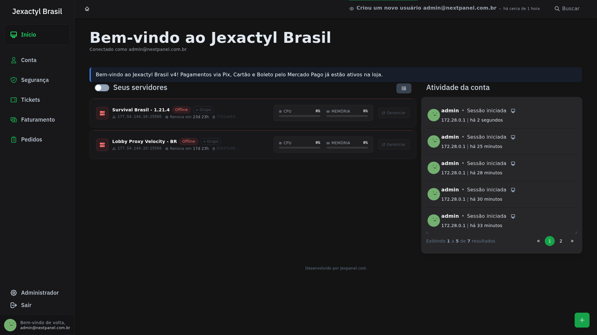
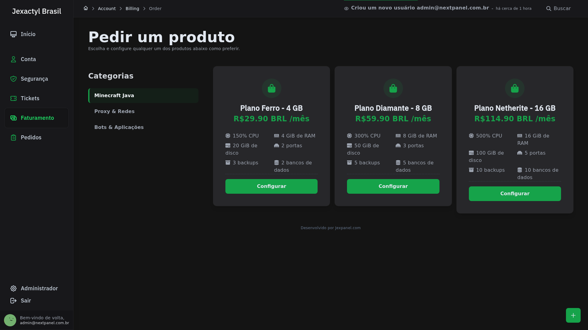
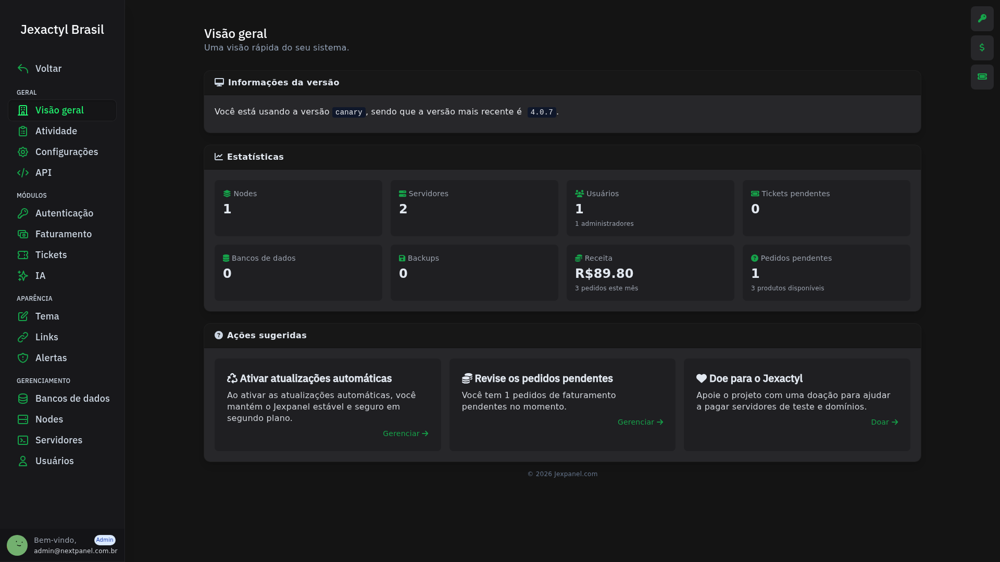
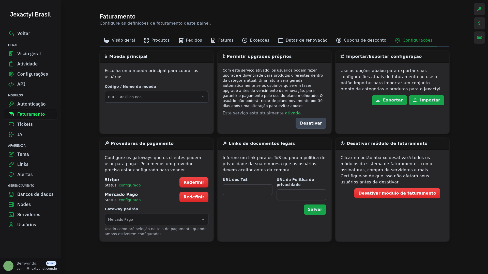

<div align="center">

# [](https://nextpanel.com.br/)


[](https://discord.gg/68k7wDGjYc)


[](https://github.com/Jexactyl/Jexactyl/releases)
[](https://github.com/Jexactyl/Jexactyl/stargazers)
[](https://github.com/Jexactyl/Jexactyl/network)

</div>

<h1 align="center">Jexactyl Brasil</h1>
<h5 align="center">
    <strong>
        Painel de gerenciamento de jogos e sistema de faturamento integrado — rápido, seguro e personalizável.<br>
        Dê aos seus usuários a vantagem em desempenho, confiabilidade e pura funcionalidade em Português do Brasil.
    </strong>
</h5>

> [!CAUTION]
> **Alerta Crítico de Segurança — Atualize da v3 imediatamente (`PHP2Shell`: CVE-2026-109618 / CVE-2026-109619)**
>
> Caso você ainda utilize o **Jexactyl v3** ou execute o painel sobre versões antigas do PHP, **atualize imediatamente para a v4 e atualize o runtime do PHP no seu servidor**.
> As vulnerabilidades críticas conhecidas como **PHP2Shell** (**CVE-2026-109618** e **CVE-2026-109619**, CVSS 9.2) afetam o interpretador PHP (versões 5.4 a 8.5 anteriores aos patches de segurança de outubro de 2026) por falhas de corrupção de memória (*Out-of-Memory `longjmp()`*) e *Use-After-Free* no *session upload progress*.
> Em painéis desatualizados, um atacante não autenticado pode ler a memória do processo (expondo `.env`, `APP_KEY`, credenciais do banco de dados e chaves de API) e executar código remotamente (RCE) no host do painel. Além disso, a árvore v3 não recebe mais correções de segurança da camada de aplicação (como a CVE-2025-49132). Migre para a **v4** e certifique-se de rodar versões corrigidas do PHP (`>= 8.4.27`, `>= 8.3.36` ou `>= 8.2.35`).

---

## Visão Geral

O **Jexpanel** (anteriormente **Jexactyl**) é um **painel de gerenciamento de servidores de jogos** moderno e de alto desempenho construído sobre o **Pterodactyl Panel**, oferecendo segurança aprimorada, personalização avançada e faturamento integrado pronto para o uso.

O **Jexactyl-BR** adapta o [Jexactyl oficial](https://github.com/Jexactyl/Jexactyl) para o ecossistema brasileiro, entregando a interface totalmente traduzida para Português do Brasil, integração nativa com métodos de pagamento nacionais e empacotamento Docker pronto para produção.

## Por que usar o Jexactyl?

* **Faturamento integrado:** Venda servidores sob demanda com geração de faturas em PDF, cupons de desconto, renovações automáticas, upgrades de recursos e histórico de pedidos.
* **Autenticação moderna e segura:** Proteja contas com Passkeys (WebAuthn), autenticação em duas etapas (2FA), proteção JGuard, cargos administrativos com permissões granulares e login social via Discord e Google SSO.
* **Interface administrativa limpa e personalizável:** Gerencie módulos, edite temas com pré-visualização em tempo real, configure alertas globais e adicione links personalizados diretamente pelo painel.
* **Operação centralizada:** Sistema nativo de chamados (tickets) para clientes, integração com IA, presets de servidores, fila de aprovação de contas e webhooks de eventos.

## O que há de diferente em relação ao Jexactyl original?

* **Tradução completa para Português do Brasil:** Mais de 20 patches modulares cobrindo a interface do cliente, console de servidor, loja, autenticação, validações do Laravel, templates de e-mail e painel administrativo, preservando a precisão de termos técnicos de infraestrutura.
* **Gateway de Pagamento Mercado Pago Nativo:** Integração nativa com o **Mercado Pago (Checkout Pro)** para recebimento via **Pix** (com aprovação automática via webhook), **Cartão de Crédito/Débito** e **Boleto**, operando em arquitetura multiprovedor lado a lado com a **Stripe**.
* **Stack Docker Pronta para Produção:** Imagem Docker baseada em PHP 8.4 + Nginx + Supervisord acompanhada de `docker-compose.yml` com MariaDB 11 e Redis, realizando geração automática de `APP_KEY`, migrações, criação do usuário administrador e execução de filas/scheduler sem configuração manual complexa.

## Links Úteis

* **Documentação Jexactyl-BR:** [nextpanel.com.br](https://nextpanel.com.br/)
* **Discord Jexactyl-BR:** [discord.gg/68k7wDGjYc](https://discord.gg/68k7wDGjYc)
* **Website & Documentação Oficial (Upstream):** [jexpanel.com](https://jexpanel.com)
* **Repositório Oficial (Upstream):** [Jexactyl/Jexactyl](https://github.com/Jexactyl/Jexactyl)
* **Discord Oficial (Upstream):** [discord.com/jexpanel](https://discord.gg/qttGR4Z5Pk)

---

## Instalação

Acesse a nossa **[Documentação Oficial (`nextpanel.com.br`)](https://nextpanel.com.br/docs/Jexactyl/intro)** para iniciar a auto-hospedagem do painel:

* [**Instalação via Docker — Recomendado**](https://nextpanel.com.br/docs/Jexactyl/v4.x.x/docker/subida-rapida)
* [**Instalação Diretamente na Máquina (Host — PHP 8.4)**](https://nextpanel.com.br/docs/Jexactyl/v4.c.x/host/dependencias)
* [**Proxy Reverso com Caddy e Nginx (Com e Sem Certificado SSL)**](https://nextpanel.com.br/docs/Jexactyl/v4.x.x/docker/proxy-reverso)
* [**Atualização e Migração (Host para Docker / v3.8.6 para v4.0.7 / Pterodactyl)**](https://nextpanel.com.br/docs/Jexactyl/v4.x.x/migracao/atualizar)
* [**Pagamentos com Mercado Pago e Stripe**](https://nextpanel.com.br/docs/Jexactyl/v4.x.x/extras/Mercado_Pago)

---

## Previews

| | |
| :---: | :---: |
| **Tela de Login**<br> | **Painel do Cliente e Servidores**<br> |
| **Loja de Planos**<br> | **Checkout (Mercado Pago e Stripe)**<br> |
| **Histórico de Pedidos e Assinaturas**<br> | **Sistema de Chamados (Tickets)**<br> |
| **Visão Geral do Administrador**<br> | **Métricas de Faturamento**<br> |
| **Provedores de Pagamento (Stripe e Mercado Pago)**<br> | **Editor de Temas em Tempo Real**<br> |

---

## Desenvolvimento e Manutenção de Patches (`jx`)

Este repositório versiona a **série de patches (`patches/`)** e os **overlays (`overlays/`)** aplicados sobre um commit exato (pin) do upstream definido em [`config.toml`](config.toml). O código do upstream vive em `.upstream/` durante o desenvolvimento local.

### Requisitos de Desenvolvimento

| Ferramenta | Versão                  |
| ---------- | ----------------------- |
| Rust / Cargo | `1.75+` (para compilar o `jx`) |
| Git        | `2.20+`                 |
| PHP        | `^8.4 \|\| ^8.5`        |
| Composer   | `2.x`                   |
| Node.js    | `>=16.13` (`pnpm 9.0.6`) |
| Banco      | MySQL 8 / MariaDB 10.6+ |

### Fluxo de Trabalho com o `jx`

```bash
# 1. Clona o upstream fixado em .upstream/ e aplica os 26 patches + overlays
make setup            # ou: jx setup (--with-deps para instalar dependências)

# 2. Valida cabeçalhos DEP-3, ordem da série, aplicação limpa e reversibilidade
make lint             # ou: jx lint

# 3. Atualiza um patch existente in-place (reaplicando os patches seguintes automaticamente)
jx refresh patches/0004-i18n-shared-runtime.patch --force

# 4. Cria um novo patch para uma nova funcionalidade
jx dump minha-feature --domain 02 --message "gateway: adiciona recurso X"

# 5. Faz rebase para uma nova tag/commit do upstream com diagnóstico detalhado de conflitos
jx rebase v4.0.8

# 6. Gera um tarball autocontido de release em dist/
jx package --version v4.0.7-br.1

# 7. Executa a suíte de testes unitários e de integração em Rust
make test
```

Documentação técnica complementar:
* [`docs/docker.md`](docs/docker.md) — Operação com Docker Compose, variáveis de ambiente e produção.
* [`docs/mercadopago-gateway.md`](docs/mercadopago-gateway.md) — Arquitetura e homologação do gateway Mercado Pago.
* [`docs/i18n-pipeline.md`](docs/i18n-pipeline.md) & [`i18n/POLICY.md`](i18n/POLICY.md) — Pipeline de tradução por categoria, catálogo e auditoria (`jx i18n-audit`).
* [`patches/README.md`](patches/README.md) & [`docs/overlays.md`](docs/overlays.md) — Regras de manutenção da série DEP-3 e overlays.

---

## Contribuição

Contribuições são bem-vindas através das *Issues* e *Pull Requests* no GitHub. Antes de abrir um PR que altere traduções ou patches, certifique-se de rodar `make lint` e `make test`.

### Isenção de responsabilidade

* A **Jexactyl Brasil (Next-Panel)** não é afiliada oficialmente ao [Jexpanel / Jexactyl](https://jexpanel.com); somos uma iniciativa independente dedicada a traduzir, adaptar e manter este painel para o Português do Brasil.
* O **Jexactyl-BR** não possui qualquer afiliação com a [Pterodactyl® Software](https://pterodactyl.io) ou com o [Jexpanel](https://jexpanel.com).

## Licença

O Jexactyl (Jexpanel) e os patches deste repositório são distribuídos sob a licença `MIT` (veja [`LICENSE`](LICENSE)). Alguns arquivos JavaScript e CSS utilizados no painel são licenciados sob `MIT` ou `Apache 2.0`; consulte os cabeçalhos dos respectivos arquivos para mais informações.

*Jexactyl não é afiliado à [Pterodactyl Software](https://pterodactyl.io).*
